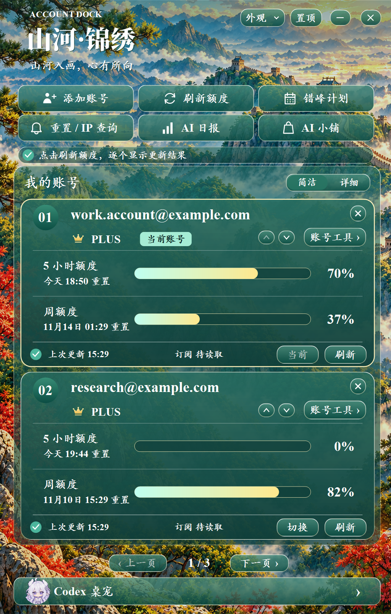

# CodexAccountDock

CodexAccountDock 是 Windows 上的 Codex 账号助手。它把账号管理、额度和订阅查询放到一个托盘面板里，适合在同一台电脑上管理多个 Codex 账号。

## 能做什么

- **账号管理**：添加账号、调整账号顺序，在已保存的账号之间切换。
- **额度与订阅**：手动刷新可查询的额度、重置时间和订阅信息。显示内容取决于账号方案及查询结果。
- **错峰计划**：为已单独授权的账号安排发送时间。配置并启用计划后才会运行。
- **账号工具**：查看本机会话与项目，使用邀请资格和订阅查询等工具。
- **外观与资讯**：切换主题、自定义背景，按需打开 AI 日报与重置／IP 查询。

## 下载与安装

到仓库的 **Releases** 选择 `v3.0.0`，再选适合你的包。

| 版本 | 适合谁 |
| --- | --- |
| **Standard** | 只需要账号管理功能。 |
| **Pet** | 希望在面板里使用桌宠入口。白龙桌宠需要另行安装。 |

`Setup.exe` 是安装包。也可以下载 `portable.zip`，完整解压到可写目录，再打开 `CodexAccountDock.exe`。初次启动时添加自己的账号。关闭主窗口后，可以从 Windows 系统托盘再次打开。

升级已有安装时，先从托盘退出程序，再运行同版本类型的安装包，并选择原安装目录以保留本地数据。便携版更新前请保留自己的 `data` 目录。

## 数据与联网

登录记录及设置保存在本机程序目录的 `data` 文件夹，账号凭据使用 Windows DPAPI 加密。切换账号会更新本机 Codex 的登录状态，必要时重新启动 Codex。登录、额度查询、资讯和 IP 查询等功能会连接对应服务。

发布包从空白配置开始。分享安装包时请从 Releases 下载，避免把自己日常使用的程序目录和账号数据一起分享。

## 界面预览

下图使用示例账号。



## 从源码构建

在 Windows PowerShell 中打开仓库目录。构建脚本使用 Windows 的 .NET Framework C# 编译器，输出位于 `release` 目录。

```powershell
.\build-release.ps1 -Edition Standard
.\build-release.ps1 -Edition Pet
```

项目源码采用 [MIT 许可证](LICENSE)。CodexAccountDock 是独立项目，与 OpenAI 无官方隶属关系。
