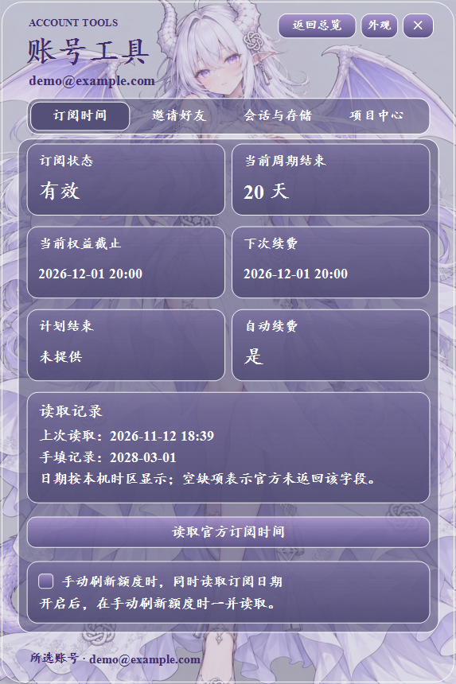
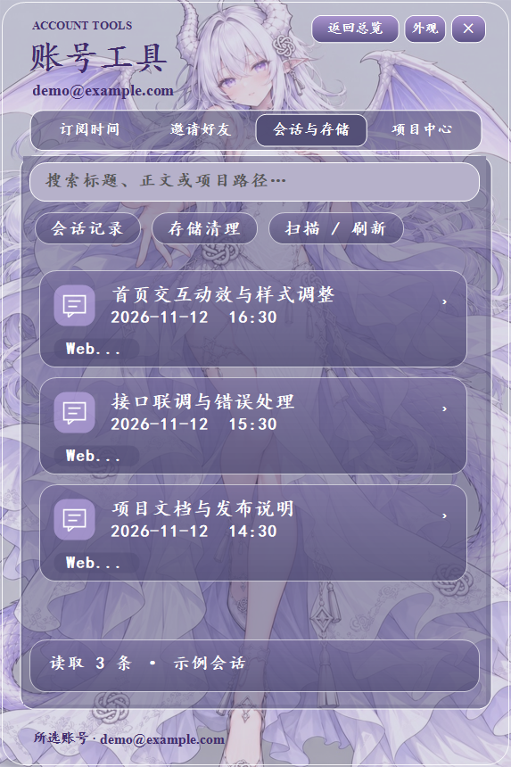
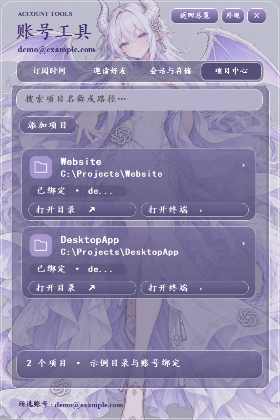

<div align="center">
  
  <p><strong>Windows 本地 Codex 账号助手</strong></p>
  <p>
    <a href="#download">下载与安装</a> ·
    <a href="#features">功能概览</a> ·
    <a href="#screenshots">实际界面</a> ·
    <a href="docs/GUIDE.md">完整使用指南</a>
  </p>
</div>

CodexAccountDock 将多账号切换、额度与订阅查询、本地会话和项目入口集中在一个 Windows 托盘应用中。支持简洁与详细视图、白龙、山河与四季主题，以及自定义背景与玻璃外观。

<a id="features"></a>

## 账号工作台

| 功能 | 可以做什么 |
| --- | --- |
| [多账号管理](docs/GUIDE.md#accounts) | 添加账号、调整顺序、分页查看，切换已保存的登录状态。 |
| [额度与 Token](docs/GUIDE.md#quota) | 手动刷新各账号可查询的额度、恢复时间、重置卡次数和累计 Token 信息。 |
| [重置卡有效期](docs/GUIDE.md#reset-cards) | 自动读取服务返回的发放与到期时间，在临期阶段显示系统托盘提醒。 |
| [订阅时间](docs/GUIDE.md#subscription) | 查看当前周期、权益截止、续费及自动续费信息，也可单独保留本机到期记录。 |
| [邀请好友](docs/GUIDE.md#invitations) | 读取个人或工作区邀请资格，填写收件邮箱，经确认后发送邀请。 |
| [错峰计划](docs/GUIDE.md#schedule) | 设置日期、时间、账号间隔与每日重复，预览发送顺序，为账号分别配置发送内容。 |

## 本地会话与项目

| 功能 | 可以做什么 |
| --- | --- |
| [会话搜索](docs/GUIDE.md#sessions) | 扫描本机当前与归档会话，按标题、正文或项目路径查找，选择记录后预览正文。 |
| [Markdown 导出](docs/GUIDE.md#export) | 将选中的本机会话保存为 Markdown，便于整理、备份和分享。 |
| [日志清理](docs/GUIDE.md#cleanup) | 预览七天未更新的旧日志，勾选后移入 Windows 回收站，显示可释放的空间。 |
| [项目中心](docs/GUIDE.md#projects) | 收藏项目文件夹、绑定账号，打开对应目录或 PowerShell 终端，并单独切换绑定账号。 |

以上入口位于账号卡片的 **账号工具** 中。会话与存储、项目中心各有独立页签。

## 查询、资讯与外观

| 功能 | 可以做什么 |
| --- | --- |
| [三来源 IP 查询](docs/GUIDE.md#ip) | 在 App 内切换原来源、IPPure、CleanIP，查看各来源返回的出口、归属与风险信息。 |
| [第三方重置预告](docs/GUIDE.md#forecast) | 手动读取公开额度重置消息，查看预计时间、消息来源和更新时间。 |
| [AI 日报](docs/GUIDE.md#news) | 手动刷新资讯，按模型、产品、行业、论文、教程和观点筛选，搜索并打开原文。 |
| [AI 小铺](docs/GUIDE.md#shop) | 手动读取第三方店铺的商品、价格与库存，打开对应商品页面。 |
| [主题与玻璃外观](docs/GUIDE.md#appearance) | 切换白龙、山河与四季主题，自选图片或视频，调整背景亮度和玻璃不透明度。 |
| [桌宠与快捷操作](docs/GUIDE.md#desktop) | Pet 版提供白龙桌宠入口，两版支持托盘唤出、置顶、开机自启与全局快捷键。 |

<a id="screenshots"></a>

## 实际界面

<table>
  <tr>
    <td align="center" width="50%"><strong>账号总览</strong><br><sub>额度、恢复时间与账号操作</sub></td>
    <td align="center" width="50%"><strong>订阅时间</strong><br><sub>周期、权益与续费信息</sub></td>
  </tr>
  <tr>
    <td align="center"><a href="docs/dashboard.png"></a></td>
    <td align="center"><a href="docs/subscription.png"></a></td>
  </tr>
  <tr>
    <td align="center"><strong>会话与存储</strong><br><sub>本地检索、正文预览与导出</sub></td>
    <td align="center"><strong>项目中心</strong><br><sub>目录、终端与账号绑定</sub></td>
  </tr>
  <tr>
    <td align="center"><a href="docs/sessions.png"></a></td>
    <td align="center"><a href="docs/projects.png"></a></td>
  </tr>
</table>

配图由 V3 程序实际渲染，账号、会话和项目均为示例数据。顶部封面为 AI 生成的宣传图。点击界面图片可查看原图。

<a id="download"></a>

## 下载与安装

> **安装器检测状态 · 2026-11-12**
> Windows Defender 已对当前发布的两个 `Setup.exe` 安装器报告威胁并执行拦截。检测原因及安装器安全性尚待确认，详情见[发行说明](https://github.com/mtlwlkqy20-blip/CodexAccountDock/releases/tag/v3.0.0)。

打开 [V3.0.0 发行页](https://github.com/mtlwlkqy20-blip/CodexAccountDock/releases/tag/v3.0.0)，按是否需要桌宠入口选择版本。两个版本均包含上面的账号、查询、会话和项目功能。

| 版本 | 包含内容 | 安装器 | 便携版 |
| --- | --- | --- | --- |
| **Standard** | 完整账号与本地工具功能 | [Setup.exe](https://github.com/mtlwlkqy20-blip/CodexAccountDock/releases/download/v3.0.0/CodexAccountDock-v3.0.0-Standard-Setup.exe) | [portable.zip](https://github.com/mtlwlkqy20-blip/CodexAccountDock/releases/download/v3.0.0/CodexAccountDock-v3.0.0-Standard-portable.zip) |
| **Pet** | 完整工具功能与白龙桌宠入口 | [Setup.exe](https://github.com/mtlwlkqy20-blip/CodexAccountDock/releases/download/v3.0.0/CodexAccountDock-v3.0.0-Pet-Setup.exe) | [portable.zip](https://github.com/mtlwlkqy20-blip/CodexAccountDock/releases/download/v3.0.0/CodexAccountDock-v3.0.0-Pet-portable.zip) |

Pet 版的桌宠需要另行安装白龙桌宠。各文件的 SHA256 见发行页中的 `SHA256SUMS.txt`，可用于核对下载是否完整。

便携版请完整解压到可写目录，再运行 `CodexAccountDock.exe`。初次打开后点击 **添加账户**，按页面完成登录。日常可从 Windows 托盘或通过 `Ctrl + Alt + D` 唤出窗口。

升级前请从托盘退出程序并备份自己的 `data` 目录。安装版选择原安装位置，便携版保留原 `data` 目录后替换程序文件。[查看安装与升级步骤](docs/GUIDE.md#installation)

## 数据与运行条件

- 运行于 Windows，构建使用 .NET Framework。窗口根据工作区与屏幕 DPI 调整显示。
- 登录记录和应用设置保存在本机程序目录的 `data` 中，账号凭据使用 Windows DPAPI 按当前 Windows 用户加密。
- 会话搜索读取本机 Codex 数据，项目中心保存目录与账号的关联记录。导出的 Markdown 包含所选会话正文。
- 登录、额度、订阅、邀请、资讯和 IP 查询等功能需要对应服务可访问。查询内容与可用字段取决于账号方案、接口和第三方服务的当次返回。
- 发布包使用空白配置。对外分享请使用发行页文件，并妥善保存自己的账号数据目录。

有关各项功能的入口、操作步骤和返回内容，见[完整使用指南](docs/GUIDE.md)。

## 从源码构建

在 Windows PowerShell 中进入源码目录，执行对应版本的构建脚本。

```powershell
.\build-release.ps1 -Edition Standard
.\build-release.ps1 -Edition Pet
```

输出位于 `release\Standard` 和 `release\Pet`。脚本包含安装器解包、文件清单和示例数据升级检查。安全软件的检测情况另见发行说明。

源码采用 [MIT 许可证](LICENSE)。CodexAccountDock 是独立项目，与 OpenAI 无官方隶属关系。
