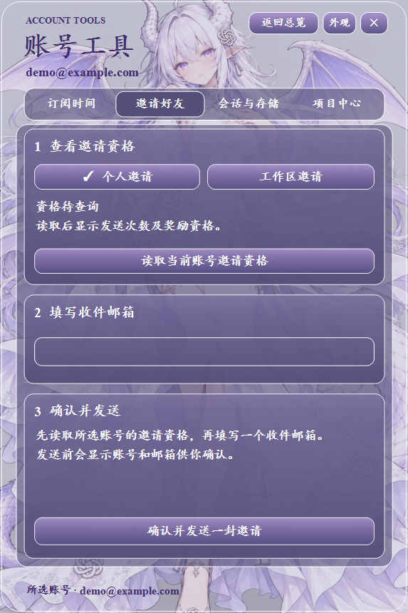
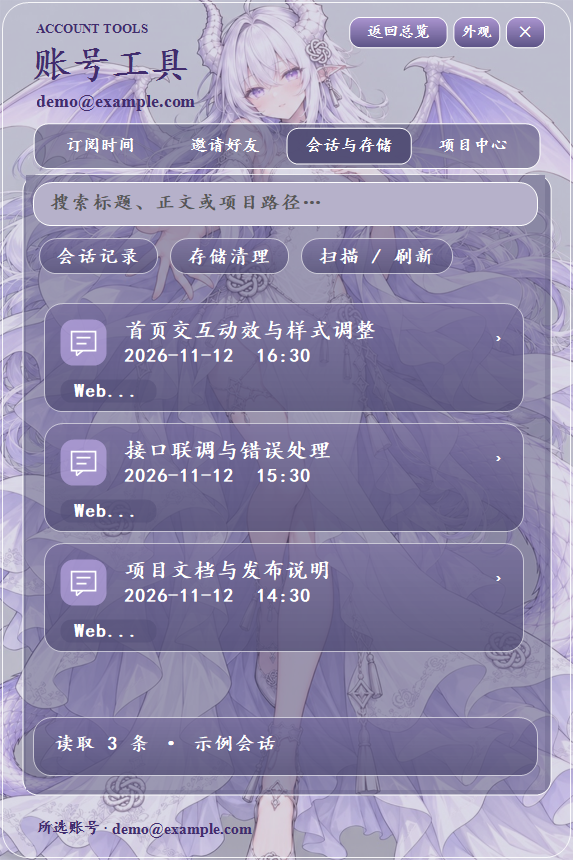
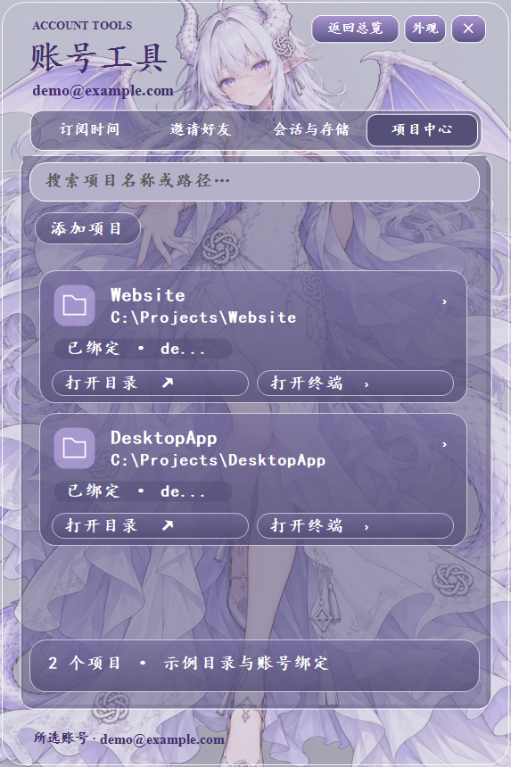

# CodexAccountDock 使用指南

[返回项目首页](../README.md) · [下载 V3](https://github.com/mtlwlkqy20-blip/CodexAccountDock/releases/tag/v3.0.0)

本指南对应 V3 公开版本。配图中的账号与内容均为示例，查询结果以实际账号及服务返回为准。

| 账号与计划 | 本地工作 | 查询与外观 |
| --- | --- | --- |
| [多账号管理](#accounts) | [会话搜索](#sessions) | [IP 查询](#ip) |
| [额度与 Token](#quota) | [Markdown 导出](#export) | [第三方重置预告](#forecast) |
| [重置卡有效期](#reset-cards) | [日志清理](#cleanup) | [AI 日报](#news) |
| [订阅时间](#subscription) | [项目中心](#projects) | [AI 小铺](#shop) |
| [邀请好友](#invitations) | [安装与升级](#installation) | [主题与玻璃](#appearance) |
| [错峰计划](#schedule) | [本地数据](#data) | [桌宠与快捷操作](#desktop) |

## 多账号管理

从主界面的 **添加账户** 开始，按照独立登录窗口的提示完成新账号授权。保存后，账号显示在总览卡片中。

- 卡片展示账号、方案和当前账号标识，可以调整账号顺序、翻页或切换简洁与详细视图。
- 点击 **切换** 使用所选账号的登录状态。切换流程会处理本机 Codex 的凭据及必要的重启，也包含本地项目和聊天归属记录的保留与合并处理。
- 通过卡片右上角关闭按钮或账号菜单移除已登记账号，按确认窗口完成操作。

账号卡片上的 **账号工具** 打开四个页签，分别为订阅时间、邀请好友、会话与存储、项目中心。

## 额度与 Token

主界面的 **刷新额度** 用于刷新账号列表，卡片上的 **刷新** 用于查询对应账号。首次查询时，按窗口提示授权访问对应服务。

查询后可显示额度剩余比例、恢复时间、最近更新时间、重置卡次数，以及可取得的账号累计 Token 信息。可显示的周期随账号方案及返回内容变化，包括 5 小时、周或月等周期。

通过 **简洁 / 详细** 控制信息密度。查询失败时查看卡片状态和最近更新时间，上次成功取得的数据可能继续显示，更新时间用于判断其时效。

## 重置卡有效期与临期提醒

刷新额度时，程序同步读取可用重置卡及服务返回的有效期。卡片底部的 **重置卡** 入口展示剩余次数、各张卡的发放时间、到期时间和最近查询时间。

程序运行期间，依据已读取的有效期，在剩余三天、一天和一小时的阶段通过 Windows 托盘提醒。时间按本机时区显示，同一张卡在同一提醒阶段会记录通知状态。

接口需要返回可解析的到期时间，才能生成对应提醒。有效期缺失时显示未知状态，提醒内容依据上次查询，收到提醒后可再次刷新以核对卡片状态。

## 订阅时间

进入 **账号工具 → 订阅时间**，点击 **读取官方订阅时间**，查看所选账号的当前订阅信息。

| 显示项 | 对应含义 |
| --- | --- |
| 订阅状态 | 服务返回的订阅是否有效 |
| 当前周期结束 | 当前周期剩余时间 |
| 当前权益截止 | 返回的权益截止时间 |
| 下次续费 | 返回的续费时间 |
| 计划结束 | 服务提供的计划结束信息 |
| 自动续费 | 服务提供的自动续费状态 |
| 读取记录 | 上次查询时间和本机手填记录 |

勾选 **手动刷新额度时，同时读取订阅日期** 后，下次主动刷新额度会一并读取订阅信息。账号菜单还提供本机订阅到期记录的设置入口，可通过日期与时间选择器填写。

日期按本机时区显示，缺失字段保留未提供状态，官方读取信息与本机手填记录分别展示。

## 邀请好友

进入 **账号工具 → 邀请好友**，选择个人邀请或工作区邀请，点击 **读取当前账号邀请资格**。

1. 核对可发送次数、奖励资格和活动说明。
2. 填写一个收件邮箱。
3. 点击发送，核对确认窗口中的账号与邮箱后确认。

资格和奖励由当次活动及账号状态决定。程序记录服务端返回的邀请状态，发送结果不明确时需要在官方客户端核对记录，再决定后续操作。

查看邀请页实际界面

## 本地会话搜索

进入 **账号工具 → 会话与存储**，点击 **扫描 / 刷新**。程序读取本机 Codex 的 `sessions` 和 `archived_sessions` 目录，按更新时间列出记录。

在搜索框输入标题、正文片段或项目路径进行查找，选择记录后查看正文。标题与项目匹配可直接使用扫描信息，正文在搜索或预览时按需读取。

读取位置遵循 `CODEX_HOME` 环境变量，默认使用 `%USERPROFILE%\.codex`。结果范围取决于这台电脑实际保存的会话文件。

## 会话导出

在会话列表中选择记录，打开 **导出 Markdown**，选择保存位置。文件包含项目路径和可读取的会话正文，可用 Markdown 编辑器打开。

源记录存在截断或无法解析的行时，导出内容会注明记录不完整。分享前请检查正文中包含的项目内容和个人信息。

## 本地日志清理

在 **会话与存储** 中切换到 **存储清理**，查看七天未更新的旧日志、已选数量及预计释放空间。勾选所需条目后，点击 **回收已选** 并确认。

当前清理范围是本机 Codex `log` 目录内符合时间条件的日志。文件通过 Windows 回收站处理，正在使用或无法访问的文件会跳过，执行结果会显示回收与跳过数量。

## 项目中心、账号绑定与启动入口

进入 **账号工具 → 项目中心**，点击 **添加项目**，选择已有项目文件夹。项目以卡片展示，可按名称或路径搜索。选中项目后可以使用绑定、切换和移除操作，卡片中还提供目录与终端入口。

- **绑定账号** 将所选项目与已登记账号关联，便于查看这个项目使用哪个账号。
- **切换绑定账号** 单独触发所选账号的切换流程。
- **打开目录** 在资源管理器打开项目文件夹。
- **打开终端** 以项目文件夹为工作目录打开 PowerShell。
- **移除项目** 从收藏列表移除对应入口，项目文件保存在原目录。

## 错峰计划

从主界面打开 **错峰计划**，设置开始与停止日期、开始与停止时间、账号间隔，以及是否每天重复。

1. 选择参与账号，为每个账号完成计划专用授权。
2. 使用统一内容，或切换到分别设置，为不同账号填写内容。
3. 核对本轮发送预览，包括参与账号和发送顺序。
4. 保存草稿，或确认内容后启用计划。

计划依赖可用的官方 Codex CLI，通过独立后台会话执行。计划页面按 `Asia/Taipei` 时区安排时间，程序需要保持运行以推进计划。发送记录可用于核对实际执行状态。

计划用于按设置向对应账号发送内容，实际额度恢复时间需要通过账号额度查询核对。

## 三来源 IP 查询

从主界面打开 **重置 / IP 查询**，切换到 **IP 查询**。底部提供三个来源按钮，默认使用原来源。

| 来源 | 结果展示 |
| --- | --- |
| 原来源 | `ip.net.coffee` 提供的出口 IP、网络信息、纯净度和可取得的安全检测项 |
| IPPure | 对应来源返回的出口、归属、运营商、ASN、风险分和住宅 IP 等信息 |
| CleanIP | 对应来源返回的出口与网络信息、纯净度评分和风险标记 |

选择来源后点击 **查询 IP** 获取该来源结果。来源选择与结果展示均在 App 内完成，也可以通过 **打开原站** 查看对应网站。

不同来源使用各自的评分口径，请结合页面上的分数含义和时间阅读。查询路径、代理配置与服务可用性会影响结果，App 查询到的出口与其他应用的连接出口可能不同。

## 第三方重置预告

在 **重置 / IP 查询** 的 **第三方预告** 页签中，点击 **刷新预告**。页面展示公开消息中的预告状态、预计时间、来源与最近查询时间，并提供来源链接。

页面根据消息中的时间区间显示过期等状态。个人账号的剩余额度和恢复时间通过主界面的 **刷新额度** 查询。

## AI 日报

从主界面打开 **AI 日报**，点击 **手动刷新** 读取资讯。可以按模型、产品、行业、论文、教程和观点切换分类，也可以输入关键词搜索当前内容。

资讯卡片提供标题与摘要等信息，点击相应入口打开原文。内容和更新情况取决于资讯来源当次返回。

## AI 小铺

从主界面打开 **AI 小铺**，手动刷新第三方店铺商品。商品卡片展示名称、分类、价格、库存和简介，点击商品可进入对应网页，**打开店铺** 用于访问店铺主页。

商品信息来自第三方店铺，实际价格、库存和交易操作以店铺页面为准。

## 主题、背景与玻璃外观

主界面的 **外观** 菜单提供主题、背景和玻璃外观设置。

- 选择山河、四季主题或白龙背景，调整界面的配色与背景内容。
- 通过更换背景选择自己的图片或兼容 MP4 视频，视频可在菜单中暂停。
- 打开 **明暗与透明度**，调节背景亮度与玻璃不透明度。拖动时可以预览，保存后保留设置，取消时恢复此前外观。
- 使用恢复默认背景入口重新应用白龙背景。

公开源码已移除此前附带的动态高清 MP4 素材。自选视频入口可用于加载用户自己的兼容文件。

## 桌宠与桌面快捷操作

Standard 和 Pet 包含相同的主要账号与工具功能。Pet 版额外提供 **Codex 桌宠** 入口，桌宠依赖另行安装的白龙桌宠程序。

| 操作 | 使用方式 |
| --- | --- |
| 显示或隐藏主界面 | 点击 Windows 系统托盘图标，或使用 `Ctrl + Alt + D` |
| 窗口置顶 | 点击主界面的 **置顶** |
| 退出程序 | 在系统托盘菜单选择 **退出** |
| 开机启动 | 在系统托盘菜单中设置 **开机自启** |
| 账号列表翻页 | 使用上一页、下一页，或 `Page Up` / `Page Down` |
| 首尾页 | 在账号列表使用 `Home` / `End` |

窗口会根据屏幕工作区和 DPI 进行适配。快捷键注册状态也会受到其他程序占用情况的影响。

## 安装与升级

当前发行页上的两个 Setup 安装器已触发 Windows Defender 拦截，检测原因与安全性仍待确认，相关状态已写入发行说明。

便携版使用流程为下载对应 `portable.zip`，完整解压到可写目录，打开 `CodexAccountDock.exe`，再添加自己的账号。

升级时先从托盘退出程序，备份当前 `data` 目录。安装版使用原安装目录，便携版替换程序文件时保留自己的 `data`。对外分享请使用发行页的干净发布文件。

## 本地数据与联网

| 内容 | 保存或处理位置 |
| --- | --- |
| 应用设置、账号记录与项目绑定 | 程序目录下的 `data` |
| 账号凭据 | 使用 Windows DPAPI 按当前 Windows 用户加密保存 |
| 本机会话 | Codex 的 `sessions` 与 `archived_sessions` |
| 日志清理范围 | Codex 的 `log` 目录中符合时间条件的旧日志 |
| Markdown 导出 | 用户在保存窗口中选择的位置 |

凭据解密依赖当前 Windows 用户环境，迁移到其他电脑时需要准备在目标电脑重新登录。会话导出包含正文，发布包保持空白配置。

登录、账号查询与邀请使用对应服务。IP、公开预告、资讯和店铺功能访问各自来源。本地会话与项目功能读取本机文件和保存的目录记录。

[返回项目首页](../README.md)
